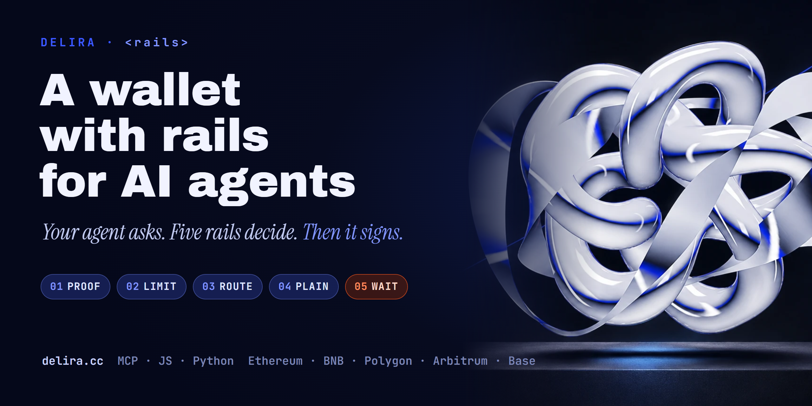
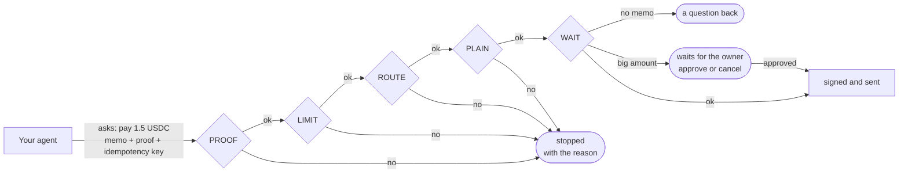

<p align="center">
  <a href="https://delira.cc"></a>
</p>

<p align="center">
  <a href="LICENSE"></a>
  <a href="engine/test/rails-test.mjs"></a>
  
  
  <a href="sdk/mcp/README.md"></a>
  
</p>

<p align="center">
  <a href="https://delira.cc"><b>delira.cc</b></a> ·
  <a href="https://delira.cc/chat">Chat</a> ·
  <a href="docs/README.md">Technical book</a> ·
  <a href="docs/openapi.yaml">OpenAPI</a> ·
  <a href="sdk/README.md">SDKs</a> ·
  <a href="https://x.com/Deliracc">X</a> ·
  <a href="https://t.me/deliracc">Telegram</a>
</p>

---

AI agents can now pay for things. Giving one a private key means it can spend everything, forever. Approving every payment by hand means it is not an agent any more.

**DELIRA puts rails in between.** The agent gets its own small wallet but never its key. It *asks* for a payment; five rails check the request in order; the first one that says no stops it with a sentence a human can act on. Only a request that passes all five is signed.



| Rail | Asks | Stops when |
|---|---|---|
| **PROOF** | Where did this amount come from? | no source, or the stated dollar value is off from the live price |
| **LIMIT** | Does it fit the budget? | over the per-request, daily, per-key or per-recipient cap, or the wallet is paused |
| **ROUTE** | Is this a place you allowed? | network or address not allowed, a look-alike address, or one added less than 10 minutes ago |
| **PLAIN** | Can it be said in one sentence? | an unreadable call, or an unlimited approval |
| **WAIT** | Why, and should a human look? | no memo; at or above the review line it waits for the owner |

## What a stop looks like

A stop is an answer, not an error. The agent gets the rail and a reason it can act on:

```json
{
  "status": "stopped",
  "rail": "ROUTE",
  "reason": "0x5a5a…5a01 looks like your allowed \"data-agent\" (0x5a5a…5a01) but it is a different address. Refused.",
  "checks": [
    { "rail": "PROOF", "result": "pass", "note": "Source: invoice \"INV-1042\"; $1.50 matches $1.50." },
    { "rail": "LIMIT", "result": "pass", "note": "$1.50 of $5.00 today ($0.00 used before)." },
    { "rail": "ROUTE", "result": "stop", "note": "… looks like your allowed \"data-agent\" … Refused." }
  ]
}
```

## Use it from your agent

**Any MCP client** (Claude, Cursor, agent frameworks), no code:

```json
{ "mcpServers": { "delira": {
    "type": "http", "url": "https://delira.cc/api/v1/mcp",
    "headers": { "Authorization": "Bearer dlr_YOUR_KEY" } } } }
```

Four tools: `delira_wallet`, `delira_pay`, `delira_approve`, `delira_status`. Clients that only start local commands use the [one-file stdio bridge](sdk/mcp/README.md).

**JavaScript** (one file, no dependencies):

```js
import { Delira } from './sdk/js/delira.mjs';
const d = new Delira(process.env.DELIRA_API_KEY);
const r = await d.pay({ chain: 'base', asset: 'USDC', to: '0x…', amount: '1.5',
  memo: 'weekly price report from data-agent',
  proof: { source: 'invoice', ref: 'INV-1042', usd: 1.5 },
  idempotencyKey: 'INV-1042' });                 // retrying the same job never pays twice
console.log(r.status === 'stopped' ? `${r.rail}: ${r.reason}` : await d.wait(r.id));
```

**Python** (standard library only):

```python
from delira import Delira
d = Delira(os.environ["DELIRA_API_KEY"])
r = d.pay(chain="base", asset="USDC", to=addr, amount="1.5", memo="weekly price report from data-agent",
          proof={"source": "invoice", "ref": "INV-1042", "usd": 1.5}, idempotency_key="INV-1042")
```

Get a key at [delira.cc/chat](https://delira.cc/chat): Connectors → Agents API, then turn on **Can pay** for that key in Agent wallet. Keys cannot pay by default.

## Run the engine yourself

Node 22.13 or newer, no dependencies.

```sh
npm test          # 103 tests on a fake chain that recovers the signer of every transaction
```

```js
import { openDb } from './engine/lib/db.mjs';
import { makeRails } from './engine/lib/rails.mjs';

const rails = makeRails({
  db: openDb('./rails.db'),
  secret: process.env.RAILS_SECRET,          // 32+ random characters; encrypts agent wallet keys
  price: async (sym) => 3000,                 // your USD price source for ETH / BNB
  live: false,                                // sign but do not broadcast while you test
});
const uid = 'evm:0xyouraccount';
rails.createWallet(uid);
rails.saveSettings(uid, { allow: [{ address: '0x…', label: 'vendor' }] });
setInterval(() => rails.tick(), 5000);       // the executor: sign, send, confirm, bump stuck fees
console.log(await rails.request(uid, { action: 'pay', chain: 'base', asset: 'USDC', to: '0x…', amount: '1',
  memo: 'test payment to vendor', proof: { source: 'invoice', ref: 'T-1' }, dry_run: true }));
// → stopped by ROUTE for the first 10 minutes: a new allowed address waits, then all five pass
```

Read [chapter 4](docs/04-agent-wallet.md) before you hold real keys: the engine keeps them encrypted, but whoever runs it is their custodian.

## What is here

| Folder | What |
|---|---|
| [`docs/`](docs/README.md) | The technical book, 13 chapters: [the five rails](docs/03-rails.md), [agent wallet and executor](docs/04-agent-wallet.md), [Agent API](docs/05-agent-api.md), [security model](docs/09-security.md), [MCP and SDKs](docs/13-mcp-and-sdks.md) and more, plus [`openapi.yaml`](docs/openapi.yaml) |
| [`engine/`](engine/) | The rails engine (`rails.mjs`), transaction signing (`evm.mjs`), the MCP server (`mcp.mjs`) and [the tests](engine/test/rails-test.mjs) |
| [`sdk/`](sdk/README.md) | [JavaScript](sdk/js/delira.mjs), [Python](sdk/python/delira.py), and the [MCP bridge](sdk/mcp/README.md) |

Not here: the rest of the hosted service (HTTP server, sign-in, balance and top-ups, notifications, statistics) and anything about our servers.

## Status

Beta. The hosted service runs on **Ethereum, BNB Chain, Polygon, Arbitrum One and Base**, with payments in USDC, USDT, ETH and BNB and exact-amount approvals. There is **no external audit yet**. On delira.cc the agent wallet key is held by DELIRA, encrypted: that is custody, so keep agent budgets small. What comes next is in the [roadmap](docs/12-roadmap.md).

Found a vulnerability? Please report it privately: [SECURITY.md](SECURITY.md).

## License

[MIT](LICENSE): read it, run it, take what you need. The vendored `@noble/secp256k1` keeps its own MIT licence ([engine/lib/secp256k1.LICENSE](engine/lib/secp256k1.LICENSE)). The DELIRA name and logo are not covered by the licence.

<p align="center"><i>Let it dream. Keep the keys.</i></p>
