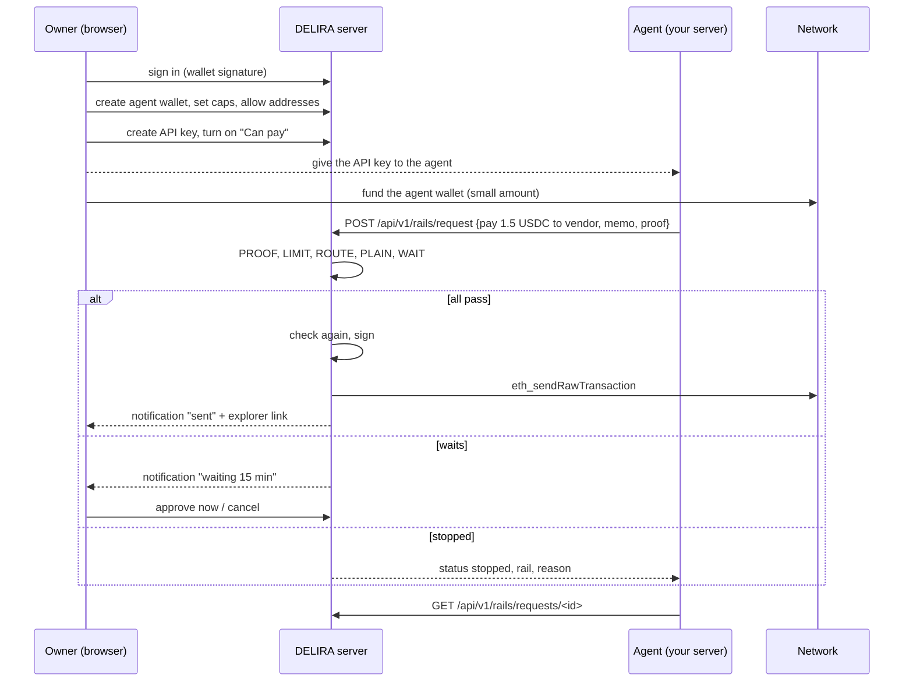

# 1 · Overview

## The problem

AI agents can now do real work: buy an API call, pay another agent for data, settle an invoice. To pay, an agent needs access to money. The usual ways to give it that access are bad:

- **Give the agent a private key.** It can do anything with the whole wallet, forever. One prompt injection, one bug, one leaked log, and the funds are gone.
- **Approve every payment by hand.** Safe, but then the agent is not autonomous, and you are the bottleneck.
- **Give it a card or a custodial account with a limit.** A limit is one rule. It does not ask where an amount came from, who receives it, or what the transaction really does.

An agent can be wrong in ways a person rarely is. It can trust a fake invoice, pay a look-alike address, sign an "approve" that hands over everything, or retry a payment and pay twice.

## The answer: rails

DELIRA puts **rails** between the agent and the money. The agent has its own wallet with a small budget, but it cannot sign. It sends a request; five rails check it in a fixed order; only if all five pass does DELIRA sign.

| The agent's mistake | The rail that catches it |
|---|---|
| A made-up or inflated amount | **PROOF**: a source is required, a stated dollar value is compared with the live price |
| Spending too much, too fast | **LIMIT**: a cap per request and per day, and a pause switch |
| Paying the wrong address, or a look-alike | **ROUTE**: only allowed addresses and networks; look-alikes are named and refused; new addresses wait 10 minutes |
| Signing something it does not understand | **PLAIN**: the transaction must be sayable in one sentence; unlimited approvals and unknown calls are refused |
| Paying without a reason, or a big amount nobody saw | **WAIT**: no memo → a question back; above the review line → a timelock the owner can cancel |
| Paying twice on a retry | `idempotency_key` + one stored signed transaction |

## What DELIRA is today

| Part | Status |
|---|---|
| Chat with free and paid models, compare mode, bring-your-own-key | live |
| Sign-in by wallet signature (EVM, Solana) or Google | live |
| Balance, free daily allowance, top-ups in USDT, USDC, ETH, BNB on five networks | live |
| Connectors: API keys, OpenAI-compatible model API, Telegram and webhook notifications, chat tools | live |
| Rails engine and agent wallet on Ethereum, BNB Chain, Polygon, Arbitrum One, Base | live, beta |
| External security audit | not done |
| Solana, TON or other non-EVM agent wallets | not built |
| Non-custodial agent wallet (smart account, user-held key) | not built, see [Roadmap](12-roadmap.md) |

## Who does what

## What DELIRA does not do

- It does not hold or see the owner's own wallet key. Signing in only proves an address.
- It does not move funds out of the owner's wallet. The owner funds the agent wallet by an ordinary transfer.
- It does not decide what is a good purchase. It enforces the owner's rules and makes the agent explain itself.
- It does not guarantee anything about third parties: a vendor on the allowed list can still be a bad vendor.
