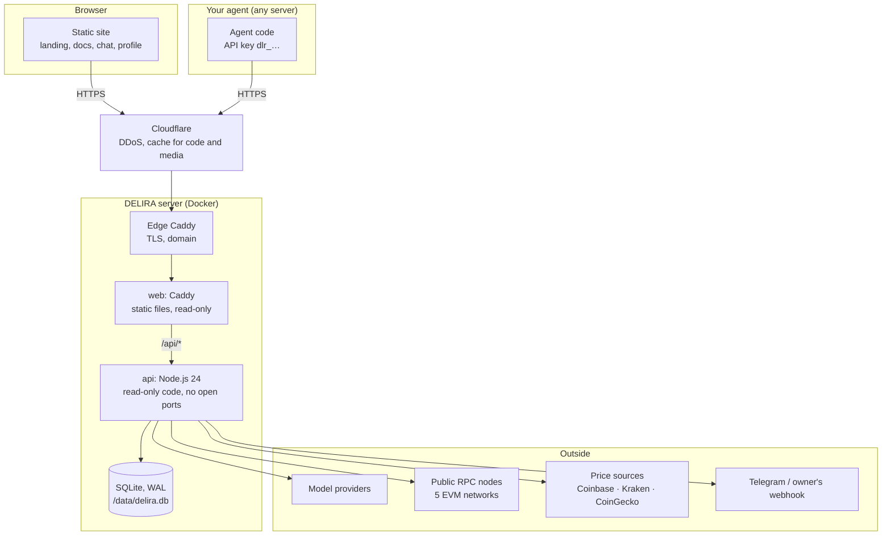
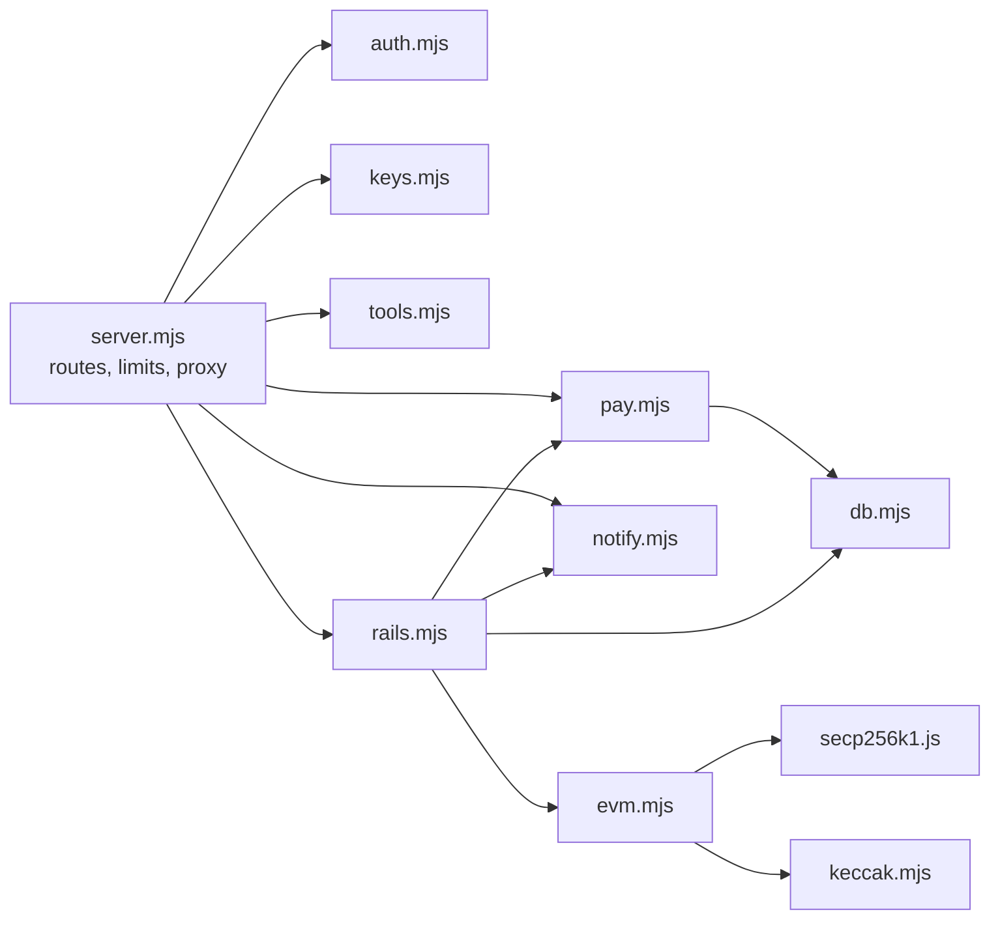
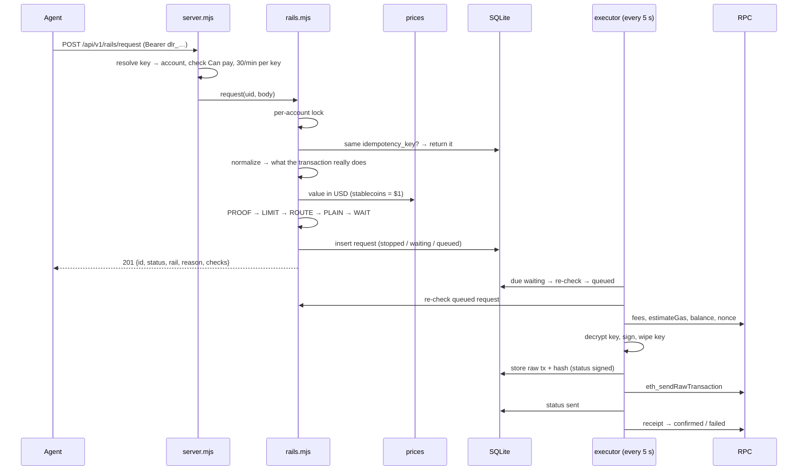

# 2 · Architecture

DELIRA is deliberately small: one static site, one Node.js process, one SQLite file. No framework and no npm dependencies on the server. The only vendored library is a reviewed copy of `@noble/secp256k1` for signatures, with its license next to it.

Small has a purpose. Fewer moving parts mean fewer places for a bug that moves money, and a reviewer can read the whole engine in an afternoon. The rails engine is about 450 lines.

## Components

| Piece | What it is | Limits |
|---|---|---|
| `web` | Caddy 2 serving the static site; `/api/*` is proxied to `api` | read-only filesystem, memory and CPU caps |
| `api` | `node /app/server.mjs` as user `node` | code mounted read-only, only `/data` is writable, memory and CPU caps, no port open to the internet |
| `/data/delira.db` | SQLite in WAL mode | the only state; back it up (it holds encrypted agent wallet keys) |
| `.env` | secrets and limits | readable only by `api`, never by the site, never committed |

The site is deployed by GitHub Actions on every push to `main` that touches public files. The API is deployed by hand (copy, then recreate the container), so a site push can never change server code.

## Modules inside `api`

Every module is a factory (`makeRails({ db, secret, price, rpcOverrides, fetchImpl, now, ... })`). Network access, time and prices are passed in, so the tests run the real code against a fake chain and a fake clock.

## Data

| Table | Holds | Written by |
|---|---|---|
| `users` | account id (`evm:0x…`, `sol:…`, `google:…`), kind, label | sign-in |
| `ledger` | every balance change, unique `(reason, ref)` so a credit is written once | top-ups, chat usage |
| `usage` | free messages used per account per day | chat |
| `invoices`, `payments` | top-up invoices with unique amounts; seen payments | deposit checker |
| `api_keys` | name, SHA-256 of the key, prefix, `pay` permission, revoked flag | owner |
| `hooks` | webhook URL and secret, Telegram bot token (AES-GCM encrypted), events | owner |
| `agent_wallets` | `uid`, address, **encrypted private key**, created | rails |
| `rails_settings` | caps, review line, timelock, networks, allowed addresses (JSON) | owner |
| `rails_requests` | every request: what, why, proof, the five checks, status, signed raw tx, hash, nonce, fees, callback | rails |
| `rails_audit` | who changed the rails, keys, approvals and withdrawals, with IP and browser | rails |
| `visits` | page views: random visitor id, page, source, utm, country, time zone, device, masked IP (kept 90 days) | site beacon |
| `signins` | sign-ins and new accounts with country and device | sign-in |

Amounts in dollars are stored as integers in micro-dollars (1 USD = 1,000,000). Token amounts are stored as strings of base units with their decimals. Nothing that moves money uses floating point.

## How a payment request travels

## Why these choices

| Choice | Why |
|---|---|
| No framework, no dependencies | The attack surface of an npm tree is larger than the whole app. Everything that signs is in this repository. |
| SQLite | One file, transactional, unique constraints do the double-spend protection; backups are one command. |
| Public RPC nodes by default, overridable per network | Works out of the box; operators can point at their own nodes with `RPC_<NETWORK>`. |
| A 5-second executor loop | Simple to reason about: at most one transaction per account per network per tick, so nonces stay in order. |
| A separate encryption secret for wallets | Rotating the session secret logs everyone out; it must never touch the wallet keys. |
