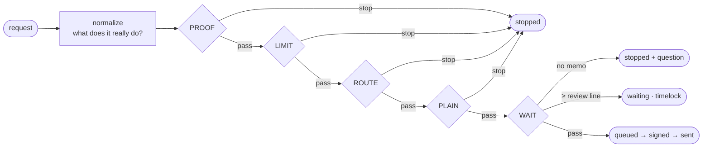

# 3 · The five rails

Every request from an agent goes through five rails in a fixed order. Each rail returns **pass**, **stop**, **wait** (only WAIT) or **n/a**. The first stop ends the check, and the request is stored as `stopped` with the rail's name and a sentence that says what to fix.



Why this order: cheap facts first, judgement last. PROOF needs the price, and every later rail talks in dollars. LIMIT is a number. ROUTE is a lookup. PLAIN needs the full picture of the call. WAIT is the human, so it comes last and only for what already passed everything else.

## Before the rails: normalize

The rails never trust the agent's description of a payment. The request is first turned into the real transaction (`to`, `value`, `data`) and then read back:

| Request | What DELIRA builds |
|---|---|
| `action: "pay"`, token | ERC-20 `transfer(to, amount)` to the token contract |
| `action: "pay"`, ETH or BNB | a plain transfer of `value` to `to` |
| `action: "approve"` | ERC-20 `approve(spender, amount)`; `amount: "unlimited"` is accepted here only so PLAIN can refuse it by name |
| `action: "raw"` | the agent's own `to`, `value`, `data`, decoded back |

For `raw`, DELIRA decodes the calldata. It recognises a plain transfer, `transfer`, `approve` and `increaseAllowance` on the known USDT and USDC contracts. A call with dirty padding in an address argument counts as unreadable. Anything else becomes "cannot say in plain words", and PLAIN stops it.

Supported assets:

| Network | Chain ID | Tokens | Native (pay and gas) |
|---|---|---|---|
| Ethereum | 1 | USDT, USDC | ETH |
| BNB Chain | 56 | USDT, USDC (18 decimals) | BNB |
| Polygon | 137 | USDT, USDC | POL (gas only) |
| Arbitrum One | 42161 | USDT, USDC | ETH |
| Base | 8453 | USDC | ETH |

## PROOF · where did the amount come from?

A payment must say where its amount came from:

```json
"proof": { "source": "invoice", "ref": "INV-1042", "usd": 1.5 }
```

| Field | Rule |
|---|---|
| `source` | one of `invoice`, `quote`, `feed`, `contract` |
| `ref` | at least 3 characters: the invoice number, the quote link, the feed name |
| `usd` | optional, except for `feed`, where it is required. If given, it is compared with DELIRA's own value |

DELIRA values the payment itself. Stablecoins count as $1. ETH and BNB use the median of Coinbase, Kraken and CoinGecko, cached for 60 seconds. If the stated `usd` is off by more than the owner's tolerance (default 2%, range 0–20%), PROOF stops:

> PROOF: The source says $15.00, but 1.5 USDC is $1.50 right now (off by 900.0%, your tolerance is 2%).

If no price can be fetched, PROOF stops rather than guessing. Approvals pay nothing now, so PROOF passes them to LIMIT and PLAIN.

**What PROOF does not do:** it cannot know that an invoice is genuine. It forces the agent to name its source, and it catches the most common failure, an amount that does not match reality. The `ref` is stored and shown to the owner.

## LIMIT · does it fit the budget?

| Check | Default | Stop message (example) |
|---|---|---|
| paused | off | The agent wallet is paused by the owner. Nothing moves until it is resumed. |
| per request | $5 | $6.00 is above the per-request cap of $5.00. |
| per day (UTC) | $5 | Daily cap $5.00: $4.00 already used today (UTC), this request is $2.00. … |

"Used today" counts every request of the UTC day that is `waiting`, `queued`, `signed`, `sent` or `confirmed`. A waiting request reserves its amount, so a second request cannot slip in while the first one waits. Owner withdrawals are not counted.

Two more caps are optional, each on top of the account caps:

| Cap | Set where | Stop message (example) |
|---|---|---|
| per API key, per day | Agent wallet → Keys that can pay | This API key has its own daily cap of $3.00: $2.00 already used by it today, this request is $1.50. |
| per recipient, per day | the allowed list ("$/day") | "data-agent" may receive at most $2.00 a day: $1.50 already today, this request is $1.00. |

A key cap lets one owner run several agents without one of them using the whole budget. A recipient cap limits the damage if one vendor turns bad.

The check and the insert run under a **per-account lock**. Five parallel $2 requests against a $5 cap give exactly two queued and three stopped (this is a test case).

An exact-amount approval is counted at its dollar value. An unlimited approval has no number, so LIMIT marks it n/a and PLAIN refuses it.

## ROUTE · is this a place you allowed?

| Check | Stop message (example) |
|---|---|
| network not on the owner's list | Polygon is not on your list of networks. |
| to the agent wallet itself | This sends to the agent wallet itself. |
| to the zero address | This sends to the zero address, where funds are lost. |
| look-alike | 0x5a5a…5a01 looks like your allowed "data-agent" (0x5a5a…5a01) but it is a different address. Refused. |
| not on the list | 0x7777… is not on your allowed list. If you trust it, add it in Settings → Agent wallet … |
| added recently | "data-agent" was added recently and becomes usable at 14:05 UTC. |

**Look-alike** means the same first 4 and last 4 hex characters as an allowed address, but a different address. That is how address-poisoning attacks work: people (and agents) check the ends. ROUTE names the address it imitates.

**Activation delay.** A new allowed address becomes usable 10 minutes after it is added (`RAILS_ALLOW_DELAY_MIN`), and the owner gets a notification. If a session is ever stolen, the attacker cannot add an address and drain the wallet in one go: the owner has 10 minutes to pause.

For an approval, ROUTE checks the **spender**. For a raw call, it checks the target the call actually reaches.

## PLAIN · can it be said in one sentence?

Before signing, DELIRA writes what will happen:

> Send 1.5 USDC on Base from the agent wallet to data-agent (0x5a5a…5a01) (about $1.50).

> Let data-agent (0x5a5a…5a01) spend up to 1.5 USDC from the agent wallet on Base.

PLAIN stops when:

| Case | Why |
|---|---|
| unknown method, unknown contract, unreadable calldata | If DELIRA cannot say it, nobody checked it. |
| an unlimited approval | It lets the spender take everything, now or later. Approve an exact amount instead. |
| a contract call that also sends ETH | Two effects in one transaction; not readable as one sentence. |

The sentence is stored with the request, shown to the owner, and sent in notifications.

## WAIT · why, and should a human look?

1. **Memo.** At least 8 characters and two words: who, what, why. Without it the request stops with a question for the agent:
   > What is this for? Send it again with a memo that says who, what and why (for example "weekly price report from data-agent").
2. **Review line.** At or above the review line (default $2), the request is stored as `waiting` with a timelock (default 15 minutes, range 1–1440). The owner is notified and can **approve now** or **cancel**. If nobody acts, it goes out when the time is up.

Before a waiting request is queued, by timer or by approval, **all rails run again** (except PROOF's price comparison, which was made at request time). If the owner paused the wallet, lowered a cap or removed the address in the meantime, it stops with "Changed while waiting: …".

## A worked example

Settings: daily $5, per request $5, review line $2, timelock 15 min, Base allowed, `data-agent` allowed.

| # | Agent asks | Result |
|---|---|---|
| 1 | 1.5 USDC to data-agent, memo, invoice INV-1 | all pass → queued → sent |
| 2 | 1.5 USDC, no proof | stopped · PROOF · No source |
| 3 | 1.5 USDC, proof says $15 | stopped · PROOF · off by 900% |
| 4 | 1.5 USDC to 0x5a5a…5a01 (look-alike) | stopped · ROUTE · looks like "data-agent" |
| 5 | unlimited approve to data-agent | stopped · PLAIN · unlimited allowance |
| 6 | 1.5 USDC, memo "pay" | stopped · WAIT · question back |
| 7 | 2.5 USDC, quote q-77 | waiting 15 min, owner notified |
| 8 | 1.5 USDC while #7 waits | stopped · LIMIT · $4.00 already used today |

Each row is a test in `api/test/rails-test.mjs`.

## Owner settings

| Setting | Default | Range | Rail |
|---|---|---|---|
| `daily_usd` | 5 | 0–100,000 | LIMIT |
| `per_tx_usd` | 5 | 0–100,000 | LIMIT |
| `paused` | false | | LIMIT |
| `chains` | all five | subset | ROUTE |
| `allow` | empty | up to 50 addresses with labels and an optional `daily_usd` each | ROUTE, LIMIT |
| `tolerance_pct` | 2 | 0–20 | PROOF |
| `wait_usd` | 2 | 0–100,000 | WAIT |
| `timelock_min` | 15 | 1–1440 | WAIT |

A change that makes the rails looser (a higher cap, a new address, a new network, resuming after a pause, a shorter timelock) always sends the owner a notification, even if they turned other notifications off.

Every change is also written to an **audit log** the owner sees under Agent wallet → Changes: when, from which IP and browser, what changed ("daily cap $5.00 → $10.00"), with looser changes marked. Key permissions, approvals, cancellations and withdrawals are logged the same way.
