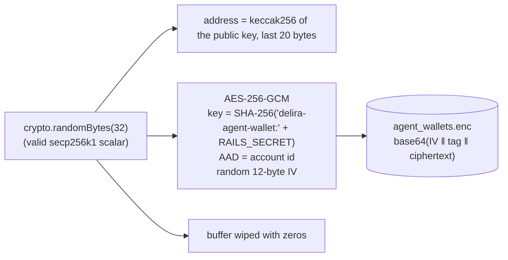
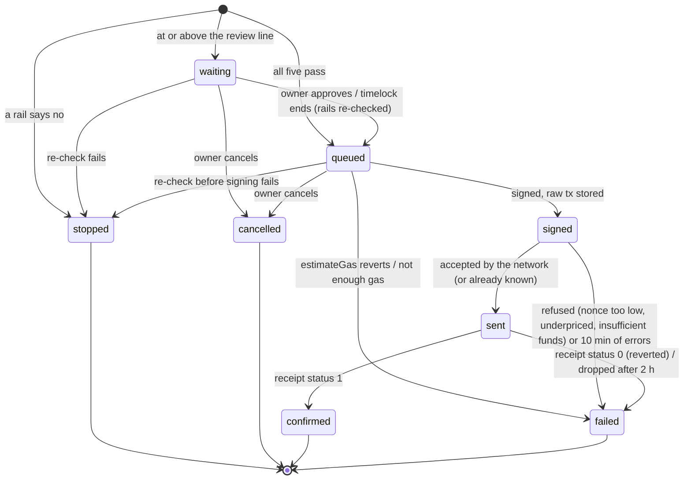

# 4 · Agent wallet and executor

## One wallet per account

Each DELIRA account can create one agent wallet: a fresh secp256k1 key with one EVM address. The address is the same on all five networks. The owner funds it with an ordinary transfer: a small amount of USDC or USDT, plus a little ETH, BNB or POL for network fees.

The agent wallet is separate from the owner's own wallet. Signing in to DELIRA only proves the owner controls an address; DELIRA never sees that key.

## Key generation and storage

| Property | How |
|---|---|
| Encrypted at rest | AES-256-GCM with a key derived from `RAILS_SECRET`, which lives only in the server's environment, not in the database |
| Bound to its account | The account id is the GCM additional data. A ciphertext copied to another account's row fails to decrypt (tested). |
| Separate secret | `RAILS_SECRET` is not the session secret. Rotating sessions never touches wallets. |
| Short life in memory | The key is decrypted only inside the signing step and wiped (`fill(0)`) right after, also on error. |
| Never shown | No route returns the key. The agent, the owner and the browser never receive it. |

### Custody, plainly

Because DELIRA must be able to sign after the rails pass, **DELIRA holds the agent wallet key**. For the money in the agent wallet, DELIRA is a custodian. Concretely:

- If the server and `RAILS_SECRET` were both compromised, an attacker could sign from every agent wallet.
- If `RAILS_SECRET` were lost, nobody (including DELIRA) could sign from any agent wallet again, and the funds in them would be stuck. Operators must keep a copy of it off the server.
- A bug in DELIRA could sign something the rails should have stopped.

This is why the defaults are small, why there is no external audit claim, and why the product says "keep only a small budget there". A non-custodial design (a smart account that enforces the rails on-chain, with the owner's key as the admin) is on the [roadmap](12-roadmap.md).

## Request lifecycle

Every status change uses a conditional update (`… WHERE id = ? AND status = ?`). If the owner cancels at the same moment as the executor signs, exactly one of them wins.

## The executor

A loop runs every 5 seconds (and right after a new request is queued):

1. **Due waits.** Waiting requests whose timelock ended are re-checked and either queued or stopped.
2. **Work.** Queued and signed requests, oldest first, **at most one per account per network per tick**. That keeps nonces in order without a separate nonce manager.
3. **Receipts.** Sent requests are checked for a receipt.

### Signing one request

| Step | Detail |
|---|---|
| re-check | All rails again with current settings (skipped for owner withdrawals) |
| fees | EIP-1559: `maxFeePerGas = 2 × baseFee + priority`. Priority from `eth_maxPriorityFeePerGas`; on Polygon at least 30 gwei (the network's minimum is 25). BNB Chain: legacy `gasPrice` with EIP-155 replay protection. |
| gas | `eth_estimateGas` from the agent wallet + 20%. A revert here fails the request with the network's reason and nothing is signed. Above 1,000,000 gas → refused. |
| balance | Native balance (pending) must cover value + gas × max fee, otherwise: "Not enough ETH in the agent wallet on Base for this and the network fee (needs about …)". |
| nonce | `max(eth_getTransactionCount(pending), last nonce DELIRA signed and sent for this wallet on this network + 1)`. Public RPC nodes behind load balancers can lag; DELIRA never trusts a lower number than its own record. |
| sign | Type 2 (EIP-1559) or legacy EIP-155, with the vendored `@noble/secp256k1`, low-s signatures |
| store | The raw signed transaction and its hash are written **before** broadcasting (status `signed`) |

### Broadcasting without paying twice

The signed transaction is stored, so a retry re-sends the **same bytes**, never a re-signed copy with a new nonce. That makes a broadcast idempotent:

| Network answer | What DELIRA does |
|---|---|
| accepted | status `sent`, owner notified with an explorer link |
| "already known" / "already imported" | it is in the mempool: `sent` |
| timeout or connection error | asks `eth_getTransactionByHash`; if seen → `sent`, if not → stays `signed`, the same bytes go out next tick |
| nonce too low, underpriced, insufficient funds | `failed` with the network's words |
| still failing after 10 minutes | `failed` |

### Confirmations

A sent transaction becomes `confirmed` when its receipt has status `0x1`, and `failed` ("included but reverted on chain") with `0x0`. If after 2 hours there is no receipt and the node does not know the hash, it is marked as dropped.

### Stuck transactions: fee bump

If a sent transaction has no receipt after 10 minutes (`RAILS_BUMP_MIN`), DELIRA replaces it: **the same nonce, the same recipient, value and data**, with fees raised by at least 25% (or to the current market fee, if that is higher). Then it waits twice as long before the next bump, at most 3 bumps.

| Rule | Why |
|---|---|
| same nonce | only one of the versions can ever be mined, so a bump can never pay twice |
| ≥ 25% higher on both fee fields | nodes require at least 10% to accept a replacement |
| check `eth_getTransactionCount(latest)` first | if the nonce is already used, a version was mined; no new signature |
| every earlier hash is kept | the receipt check looks at all of them, and the request ends with whichever was mined |
| balance check before signing | the higher fee must still be affordable |

The owner sees "DELIRA raised the fee N×" on the request.

## Withdrawals

The owner can move funds out of the agent wallet at any time:

- only to the EVM address they signed in with, or to an **active** allowed address;
- caps, the review line and the timelock do not apply (it is the owner, not the agent);
- `amount: "all"` for a token sends the whole token balance; for ETH, BNB or POL it keeps the estimated fee × 2 plus a small reserve on Base and Arbitrum for the L1 data fee.

Withdrawals go through the same executor: same fee logic, same stored-raw-transaction rule. They are not counted in the daily cap.

## Status callbacks

An agent can pass `callback_url` (https, public host) with a request. On every status change DELIRA POSTs the request to it, signed with HMAC-SHA-256 where the secret is the SHA-256 (hex) of the agent's API key. A failed delivery is retried after 30 s, 1, 2, 4 and 8 minutes; after that DELIRA gives up on that status and tries again on the next change. The same SSRF checks apply as for owner webhooks. If the key is revoked, nothing is sent.

## Operator controls

| Switch | Effect |
|---|---|
| `RAILS_LIVE=0` | Test mode: everything is checked and signed, nothing is broadcast. The owner sees a "Test mode" banner. |
| `RAILS_BUMP_MIN` | Minutes before the first fee bump (default 10). |
| `RAILS_HALT=1` | Emergency halt: requests are still checked and stored, but nothing new is signed for any account. Already sent transactions are still followed to a receipt. The owner sees "Halted by DELIRA". |
| owner **Pause** | Per account: LIMIT stops every request, and queued ones stop at the re-check before signing. |
