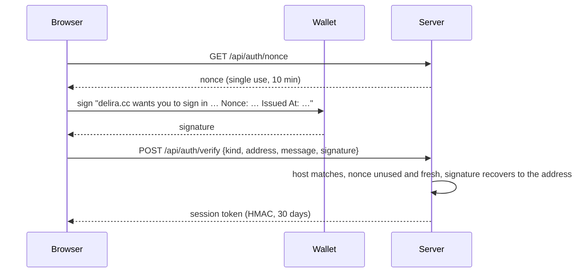

# 7 · Accounts and balance

## Sign-in by signature

DELIRA has no passwords. An account is an address (or a Google identity) that proved itself.

| Kind | Account id | Check |
|---|---|---|
| EVM (MetaMask, Rabby, Coinbase Wallet, …) | `evm:0x…` | `personal_sign`, secp256k1 public key recovery, address compared |
| Solana | `sol:<base58>` | ed25519 signature over the same kind of message |
| Google | `google:` | ID token: signature against Google's published keys, audience, issuer, expiry |

The message is SIWE-style: it names the host, so a signature collected on another site does not work here. Each nonce works once. The server only ever checks signatures; it never asks for or receives a key or a seed phrase.

The session token is stateless: the account id and expiry, signed with HMAC-SHA-256 under `SESSION_SECRET`. Changing that secret signs everyone out and touches nothing else.

## Free allowance and the balance

| Rule | Default |
|---|---|
| Free messages per account per day on the free models | 30 (`FREE_PER_DAY`) |
| Free models | `gpt-6-luna`, `gpt-5.6-luna` (`FREE_MODELS`) |
| After that, or on other models | charged from the balance by tokens at the listed price per 1M tokens |
| Minimum top-up | $2 (`MIN_TOPUP_USD`) |

Every charge and credit is a row in `ledger` with a unique `(reason, ref)`, so the balance is always the sum of its history and nothing is counted twice.

## Top-ups in crypto

The balance is topped up by sending crypto to one public deposit address. That address is receive-only: **the server has no key for it and cannot send from it.** (The agent wallet in [chapter 4](04-agent-wallet.md) is a different thing.)

### Unique amounts

An invoice asks for a slightly unique amount, for example **10.0044 USDT** on Arbitrum. The extra digits identify the invoice, so a transfer is matched by amount without a memo field. An invoice lives 30 minutes, plus a grace period.

### The deposit checker

Every 15 seconds:

| Asset | How a payment is found |
|---|---|
| USDT, USDC | ERC-20 `Transfer` logs to the deposit address, block range by block range |
| ETH, BNB | the deposit address's balance; when it changes, the block is found by bisection |

A payment is credited only after confirmations, and after re-reading the block hash (if the block was reorganised away, it is not credited):

| Network | Confirmations |
|---|---|
| Ethereum | 12 |
| BNB Chain | 15 |
| Polygon | 64 |
| Arbitrum One | 20 |
| Base | 15 |

A late payment of the exact amount is still credited within 24 hours. A payment with an amount or coin that matches no invoice goes to an "unmatched" list for the operator to credit by hand.

### Prices

ETH and BNB are valued at the **median** of Coinbase, Kraken and CoinGecko, cached for 60 seconds. A median of three does not move if one source is wrong or down. The same price function serves the rails (PROOF and LIMIT).
