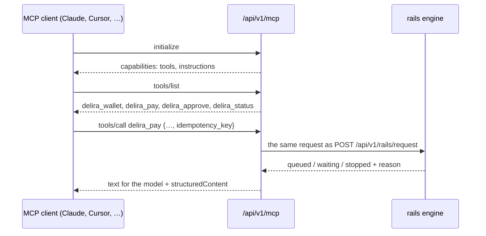

# 13 · MCP and SDKs

The [Agent API](05-agent-api.md) is plain HTTP, so any language can use it. Most agents do not need to: DELIRA speaks MCP, and there are one-file clients for JavaScript and Python. All of them only **ask**. The rails decide on the server.

## MCP server

`POST https://delira.cc/api/v1/mcp` with `Authorization: Bearer dlr_…`.

It implements the MCP Streamable HTTP transport in its simplest form: every POST carries one JSON-RPC message (or a batch) and gets a JSON response. There are no sessions and no server-sent stream (GET returns 405). Protocol versions: 2025-06-18, 2025-03-26, 2024-11-05.

| Tool | Annotations | What it does |
|---|---|---|
| `delira_wallet` | read-only | address, balances, caps, used today, networks, allowed addresses (with their caps), whether this key can pay |
| `delira_pay` | destructive, idempotent | asks for a payment; `memo`, `proof_source`, `proof_ref` and `idempotency_key` are required by the schema |
| `delira_approve` | destructive, idempotent | asks for an exact ERC-20 allowance |
| `delira_status` | read-only | a request by id |

Design choices:

- **`idempotency_key` is required.** Models retry. The schema makes them name the job, so a retry returns the same request.
- **A stop is a normal result.** It is not `isError`. The text tells the model what happened and what to do: "STOPPED by ROUTE … Next: do not retry the same request. Tell the user what the rail said."
- **A key without Can pay gets read-only behaviour.** `delira_pay` answers with `isError` and says how the owner can allow it.
- **Same rate limit family as the API**: 60 MCP messages a minute per key.

Client configuration and the stdio bridge are in [`sdk/mcp`](../sdk/mcp/README.md).

## Stdio bridge

`sdk/mcp/delira-mcp.mjs` is about 40 lines. It reads newline-delimited JSON-RPC from stdin, POSTs each message to the remote server with the key from `DELIRA_API_KEY`, and writes the answers to stdout. Clients that can only start local commands use it. It has no dependencies and keeps no state.

## JavaScript and Python

| | JavaScript | Python |
|---|---|---|
| File | `sdk/js/delira.mjs` | `sdk/python/delira.py` |
| Runtime | Node 18+, Deno, Bun, browsers | Python 3.8+, standard library |
| Methods | `wallet`, `pay`, `approve`, `check`, `status`, `wait`, `verifyCallback` | `wallet`, `pay`, `approve`, `check`, `status`, `wait`, `verify_callback` |

Both follow the same rules:

- `pay` and `approve` require an idempotency key.
- A rail stop is returned as a result. Only HTTP errors raise `DeliraError` (with `.status`).
- `wait` polls every 5 seconds, and every 30 seconds while a request waits for the owner.
- `verifyCallback` checks a status callback: HMAC-SHA-256 of the raw body with `sha256_hex(api key)` as the secret, in constant time.

## Which to use

| You have | Use |
|---|---|
| Claude, Cursor or another MCP client | the remote MCP server, or the stdio bridge |
| An agent framework with MCP support | the remote MCP server |
| Your own JavaScript or Python service | the SDK file |
| Anything else | the HTTP API in [chapter 5](05-agent-api.md) |
