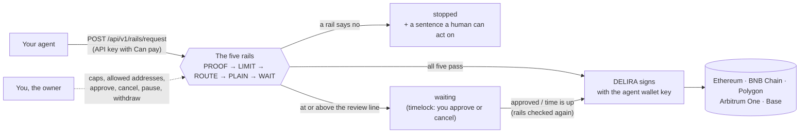

# DELIRA · technical book

**A wallet with rails for AI agents.** An agent gets its own small budget. It cannot spend that budget alone: every payment it asks for passes five checks (PROOF, LIMIT, ROUTE, PLAIN, WAIT) before DELIRA signs anything.

This book explains how DELIRA works: what each part does, why it is built that way, and where its limits are. It is written for developers who connect an agent, for reviewers who want to check the design, and for whoever runs the server.

> **Status: beta.** The chat, sign-in, balance, connectors and the rails engine with the agent wallet are live on Ethereum, BNB Chain, Polygon, Arbitrum One and Base. There is no external audit yet. The agent wallet is custodial (see [Custody](04-agent-wallet.md#custody-plainly)). Keep only a small budget there.

Site: [delira.cc](https://delira.cc) · Chat: [delira.cc/chat](https://delira.cc/chat) · User docs: [delira.cc/docs](https://delira.cc/docs)

## The idea in one picture

The agent never holds a key. It can only *ask*. The rails decide, and the first rail that says no stops the request with a reason a person can read.

## Chapters

| # | Chapter | What is inside |
|---|---|---|
| 1 | [Overview](01-overview.md) | The problem, the product, what is live, what is not |
| 2 | [Architecture](02-architecture.md) | Components, hosting, data, how a request travels |
| 3 | [The five rails](03-rails.md) | Each rail in depth: what it checks, the exact stop messages, the order |
| 4 | [Agent wallet and executor](04-agent-wallet.md) | Key generation and encryption, custody, signing, fees, nonces, rebroadcast, confirmations, withdrawals |
| 5 | [Agent API](05-agent-api.md) | Endpoints for your agent: request schema, responses, errors, idempotency, examples in curl, JavaScript and Python |
| 6 | [Owner API](06-owner-api.md) | What the signed-in owner can call: settings, approvals, withdrawals, keys |
| 7 | [Accounts and balance](07-accounts-and-balance.md) | Sign-in by signature, the free allowance, top-ups in crypto and the deposit checker |
| 8 | [Connectors](08-connectors.md) | API keys, the OpenAI-compatible model API, notifications (Telegram, signed webhooks), chat tools |
| 9 | [Security model](09-security.md) | Threats and what stops each one, secrets, what is not covered |
| 10 | [Operations](10-operations.md) | Environment, deploy, backups, test mode, emergency halt, rollback |
| 11 | [Testing](11-testing.md) | Test suites, what they prove, what was checked on real networks, what was not |
| 12 | [Roadmap](12-roadmap.md) | What comes next, without dates |
| 13 | [MCP and SDKs](13-mcp-and-sdks.md) | The rails as MCP tools for any agent; one-file clients for JavaScript and Python; status callbacks |
| — | [Glossary](glossary.md) | Terms used in this book |
| — | [OpenAPI spec](openapi.yaml) | Machine-readable Agent API: import it into Postman, Insomnia or a code generator |
| — | [Changelog](../CHANGELOG.md) | What changed and when |
| — | [Security policy](../SECURITY.md) | How to report a vulnerability |

## Five rails, five lines

| Rail | Question it asks | Stops when |
|---|---|---|
| **PROOF** | Where did this amount come from? | No source, or the stated dollar value is off from the live price by more than your tolerance |
| **LIMIT** | Does it fit the budget? | Above the per-request cap, above what is left of the daily cap (of the account, of this API key, or of this recipient), or the wallet is paused |
| **ROUTE** | Is this a place you allowed? | Network not allowed, address not on your list, a look-alike of an allowed address, or added less than 10 minutes ago |
| **PLAIN** | Can it be said in one sentence? | DELIRA cannot read the call, or it is an unlimited approval |
| **WAIT** | Why, and should a human look? | No memo (the agent gets a question back); at or above the review line it waits on a timelock |

## Principles

1. **Ask, don't hold.** The agent gets an API key that can *ask* for a payment. It never sees a private key.
2. **The first no wins, with a reason.** Every stop carries a sentence that says what to fix.
3. **Strict by default.** $5 a day, $5 per request, review from $2 with a 15-minute timelock, and no allowed addresses until you add them. API keys cannot pay until you turn it on per key.
4. **Check twice.** The rails run when the request arrives and again right before signing.
5. **Never pay twice.** The same `idempotency_key` returns the same request; a signed transaction is stored and re-sent as is, never re-signed with a new nonce.
6. **Say what we hold.** The agent wallet key is on DELIRA's server, encrypted. That is custody, and this book says so wherever it matters.

## Reading the code

This repository holds the rails engine and its tests. The rest of the hosted service (the HTTP server, sign-in, balance and top-ups, notifications, statistics) is described in this book but not published.

| File | Role |
|---|---|
| [`engine/lib/rails.mjs`](../engine/lib/rails.mjs) | The rails engine: agent wallets, the five checks, the executor, fee bumps, callbacks, the audit log |
| [`engine/lib/evm.mjs`](../engine/lib/evm.mjs) | RLP, transaction signing (EIP-1559 and legacy EIP-155), ERC-20 calldata, call decoding |
| [`engine/lib/mcp.mjs`](../engine/lib/mcp.mjs) | MCP server: the rails as four tools |
| [`engine/lib/networks.mjs`](../engine/lib/networks.mjs) | Networks and token contracts the rails support |
| [`engine/lib/keys.mjs`](../engine/lib/keys.mjs) | API keys (`dlr_…`), stored as SHA-256 only, with the Can pay permission and per-key caps |
| [`engine/lib/db.mjs`](../engine/lib/db.mjs) | SQLite tables (Node's built-in `node:sqlite`) |
| `engine/lib/keccak.mjs`, `secp256k1.js` | Keccak-256 and the vendored `@noble/secp256k1` (MIT, its licence file beside it) |
| [`engine/test/rails-test.mjs`](../engine/test/rails-test.mjs) | 103 tests against a fake chain that recovers the signer of every transaction |
| [`sdk/`](../sdk/README.md) | MCP stdio bridge, JavaScript and Python clients |

License: MIT, see [LICENSE](../LICENSE).
